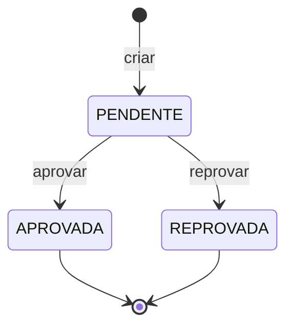
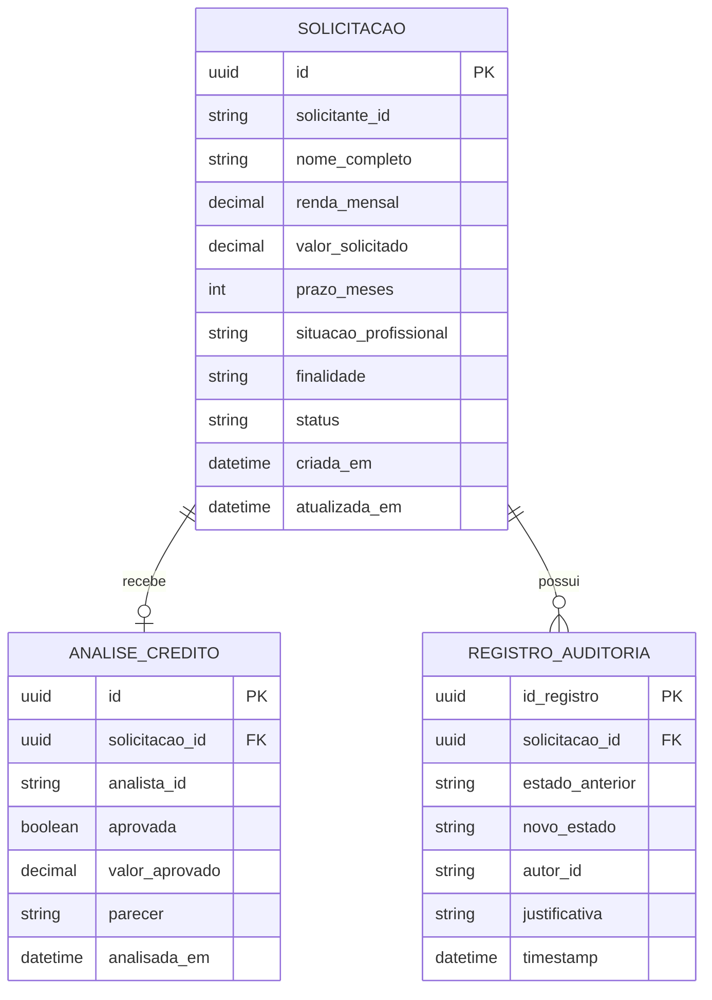

# CredFácil — Solicitação de Empréstimo e Análise de Crédito

Trabalho de Programação Web 2. Back-end NestJS/TypeScript, front-end Next.js/React e persistência **atual** em arquivo JSON (integração PostgreSQL pendente).

## Arquitetura limpa (NestJS)

`backend/src/domain`: entidade, enums, regras de negócio, erros e contrato do repositório.
`backend/src/application`: casos de uso de criar, listar, buscar, atualizar, excluir e analisar solicitações.
`backend/src/infra/database`: implementação do repositório com JSON.
`backend/src/infra/http`: controllers, DTOs, validação, guard de perfil e filtro de erros do Nest.

O domínio e os casos de uso não dependem do NestJS. Os controllers recebem as requisições e chamam os casos de uso. A implementação JSON pode ser substituída por outro banco mantendo o contrato do repositório.

## Como executar

Requer Node.js 20+. Em um terminal: `cd backend`, `npm install`, `npm run start:dev`. API em `http://localhost:8000`. Em outro terminal: `cd frontend`, `npm install`, `npm run dev`. Site em `http://localhost:3000`.

## Telas

- `/`: entrada do CredFácil.
- `/solicitar`: incluir solicitação.
- `/minhas-solicitacoes`: listar, alterar e excluir solicitações do usuário.
- `/solicitacoes/:id/editar`: formulário de alteração.
- `/analise`: fila de análise e decisão do analista.

## Regras de negócio

- Um solicitante só pode manter uma solicitação pendente por vez.
- Somente o próprio solicitante pode alterar ou excluir seu pedido, enquanto estiver pendente.
- Solicitações analisadas não podem ser alteradas ou excluídas pelo solicitante.
- O analista pode aprovar o valor integral ou um valor menor que o solicitado, ou reprovar com parecer obrigatório.
- Projeto acadêmico: não consulta birôs de crédito nem realiza contratação financeira real.

## Rotas da API

| Método | Rota | Ação |
|---|---|---|
| POST | `/solicitacoes` | Incluir |
| GET | `/solicitacoes` | Listar solicitações do usuário |
| GET | `/solicitacoes/:id` | Buscar uma solicitação |
| PUT | `/solicitacoes/:id` | Alterar |
| DELETE | `/solicitacoes/:id` | Excluir |
| GET | `/analise-credito/fila` | Listar fila de análise |
| PATCH | `/analise-credito/:id/avaliar` | Aprovar/reprovar |

As rotas do solicitante usam `x-user-id`. As rotas de análise exigem `x-role: ANALISTA` e `x-user-id` na avaliação.

## Diagrama de estados

Apenas analistas podem aprovar/reprovar, não podem analisar a própria solicitação, e estados finais não podem ser alterados. Edição/exclusão pelo solicitante são permitidas somente enquanto PENDENTE.

## DER — modelo relacional **planejado** para PostgreSQL

> **Ainda não implementado no banco.** Este diagrama é uma proposta de modelagem para a próxima etapa; o projeto atualmente persiste em JSON. Ajustar o DER conforme as migrations efetivamente criadas.

## Testes e build

Em `backend`: `npm ci`, `npm test`, `npm run build`.
Em `frontend`: `npm ci`, `npm run build`.
No PowerShell, caso `npm.ps1` seja bloqueado, use `npm.cmd` no lugar de `npm`.

## Auditoria e segurança

`GET /analise-credito/:id/auditoria` permite ao perfil `ANALISTA` consultar o histórico. O backend ainda usa `x-user-id` e `x-role` fornecidos pelo cliente: **não há autenticação real**. A gravação JSON não equivale a transação ACID; as garantias relacionais devem ser implementadas no PostgreSQL.

## Documentação adicional

- [Arquitetura e decisões técnicas](docs/arquitetura.md)
- [Uso de IA, prompts e revisão crítica](docs/ai-decisions.md)
- [Índice do registro de IA](AI-LOG.md)
