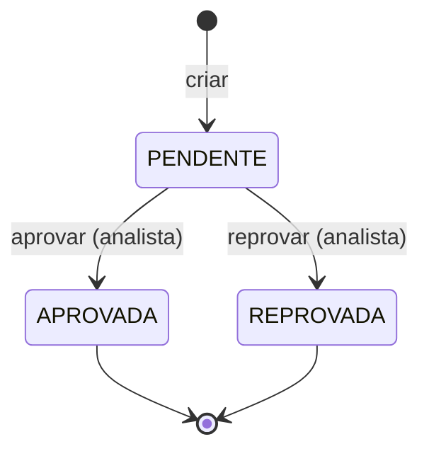

# Arquitetura e decisões técnicas — CredFácil

## Camadas

- `backend/src/domain`: entidade `SolicitacaoEmprestimo`, enums, erros e contrato `SolicitacaoRepository`.
- `backend/src/application/use-cases`: operações de criação, consulta, edição, exclusão, fila e análise.
- `backend/src/infra/http`: controllers NestJS, DTOs, guard de papéis e tratamento HTTP.
- `backend/src/infra/database`: implementação JSON de `SolicitacaoRepository`.
- `frontend`: interface Next.js para solicitar, acompanhar e analisar pedidos.

## Máquina de estados atual

Não existem transições de saída de APROVADA/REPROVADA. A entidade rejeita segunda decisão. `editar` e `excluir` são permitidos somente ao proprietário e enquanto PENDENTE. A decisão é exclusiva do papel ANALISTA e o analista não pode avaliar o próprio pedido.

## Regras de negócio implementadas

- Valor solicitado entre R$ 100 e R$ 1.000.000; renda positiva; prazo inteiro entre 1 e 120 meses.
- Valor aprovado positivo e não superior ao solicitado.
- Parcela estimada **sem juros** (`valorAprovado / prazoMeses`) limitada a 30% da renda mensal. É uma **hipótese acadêmica**, não análise financeira real.
- Parecer do analista com no mínimo três caracteres.
- Uma solicitação pendente por solicitante (verificação no caso de uso).
- Registro de auditoria na aprovação/reprovação: identificador, solicitação, estados, autor, justificativa e timestamp.

## Concorrência e auditoria — limitações

`JsonDatabaseService` serializa alterações dentro do processo Node e `salvarComAuditoria` compara o estado anterior antes de persistir a decisão e o histórico juntos. Entretanto, o arquivo JSON **não oferece transação ACID**, proteção contra múltiplas instâncias, durabilidade garantida contra interrupção durante escrita nem restrições relacionais. A migração para PostgreSQL, com transações e constraints, permanece pendente.

## Autorização — limitação

O guard utiliza o cabeçalho `x-role` e a identificação `x-user-id`. Isso **não é autenticação confiável**: um cliente pode forjar esses valores. Uso acadêmico/demonstrativo, não adequado para produção sem autenticação real e identidade verificada no servidor.

## SOLID (interpretação da estrutura atual)

- **SRP:** domínio contém regras, casos de uso orquestram operações, controllers lidam com HTTP, repositório cuida da persistência.
- **OCP / inversão de dependência:** o contrato `SolicitacaoRepository` permite adicionar implementação PostgreSQL sem reescrever o domínio, mas isso ainda precisa ser comprovado com a integração.
- **LSP:** a implementação PostgreSQL deverá respeitar o mesmo comportamento observável do contrato, incluindo erros, auditoria e consistência; ainda não verificado.

## Verificação

Na etapa anterior, o usuário executou 16 testes Vitest com sucesso e os builds NestJS/Next.js concluíram. Isso não substitui testes de integração HTTP, segurança ou transações PostgreSQL.
